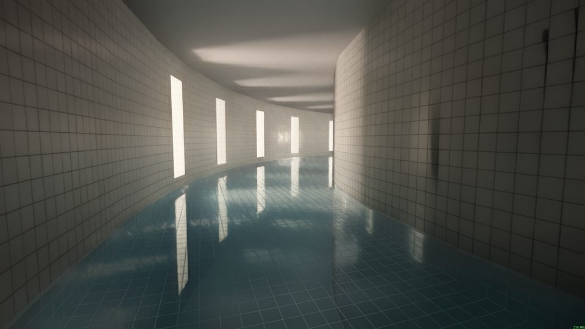
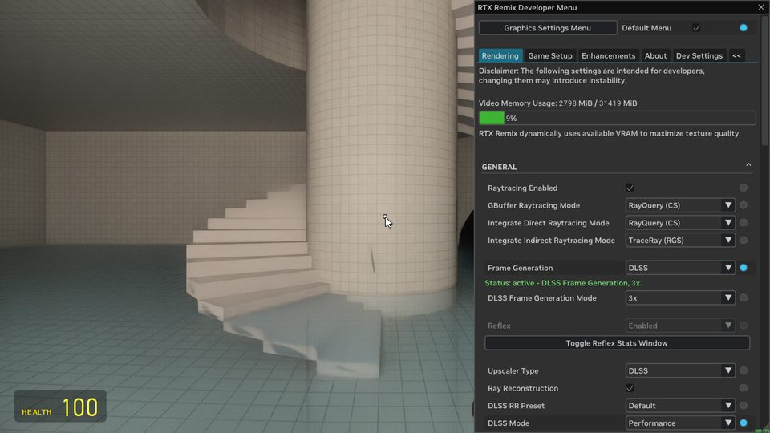

<div align="center">

# RTX Remix for Garry's Mod

**Full path tracing in 64-bit Garry's Mod, in your normal Steam install.**<br>
One file in the game folder and one Workshop subscription. No patched copy of the game, and no
fighting Steam updates.

[](https://github.com/SheepyLord/-Gmod-Workshop-RTX-Remix/actions/workflows/build.yml)
[](https://steamcommunity.com/sharedfiles/filedetails/?id=3829070317)
[](#requirements)
[](LICENSE)



[Features](#features) · [Requirements](#requirements) · [Installation](#installation) ·
[Troubleshooting](#troubleshooting) · [FAQ](#faq) · [Download](https://github.com/SheepyLord/-Gmod-Workshop-RTX-Remix/releases/latest)

</div>

## About

[RTX Remix](https://www.nvidia.com/en-us/geforce/rtx-remix/) adds full path tracing to classic
DirectX 8 and 9 games. This project brings it to Garry's Mod without changing the game itself. You
add one file, `bin\win64\winmm.dll`, and subscribe to the RTX package on the Steam Workshop. Each
time the game starts, the loader installs or updates the package and loads RTX Remix before the game
sets up its graphics.

The loader never patches Steam's files, so game updates and **Verify integrity of game files** keep
working. You can turn RTX off with a setting, or delete the one file to get plain Garry's Mod back.

## Features

**An install that stays out of your way**

- One file in the game folder. Everything else comes through the Steam Workshop and updates
  automatically.
- Steam's files are never patched, so game updates and file verification keep working.
- Easy to switch off: a setting turns RTX off, the `-nonativeloader` launch option skips it for one
  session, and deleting the file removes it.
- Your files are respected. Remix's `user.conf` is never touched, and anything the loader has to
  replace is backed up and put back when the package is removed.
- It moves over an existing RTXLauncher setup in the same folder, backing up what it replaces.

**Ready to play**

- An **RTX Remix** tab in the spawn menu gathers every RTX setting, with a *Start here* page and an
  in-game guide, in seven languages (English, French, Japanese, Korean, Russian, and Simplified and
  Traditional Chinese).
- Settings matched to your graphics card: on NVIDIA GPUs the loader picks a high, medium or low
  performance tier from the card's model and video memory.
- A physical sky with the sun, moon and stars, moon phases and eclipses, and twelve weather presets
  that blend into each other.
- Glass that cracks where it is hit and shatters into pieces simulated with Jolt Physics. The pieces
  pile up, get pushed around by props and ragdolls, and break again under bullets and explosions.
- Multiplayer support, including servers with `sv_allowcslua 0`, without `-insecure`.
- ReShade for RTX sessions, picking up the ReShade presets you already use.
- RTX content from other Workshop items, such as a character's PBR materials, loads automatically.

**Tools included in the RTX package**

Model Hotloader, Advanced Material Editor, Advanced Bodygroup Tool, Procedural Bodygroup Destruction
and the Character Motion Importer.

**Help when something goes wrong**

- After a crash, a message explains the likely cause (for example running out of video memory or a
  lost GPU) and what to try next.
- Logs, crash dumps and memory history from your last five sessions are kept in
  `native-loader\logs\sessions`. They stay on your PC and are never uploaded.

## Requirements

| | |
|---|---|
| **System** | Windows 10 or 11, 64-bit |
| **Game** | Garry's Mod on Steam, on the **x86-64** beta branch |
| **Graphics card** | A GPU with hardware ray tracing: NVIDIA GeForce RTX 20 series or newer (recommended), AMD Radeon RX 6000 series or newer, or Intel Arc |
| **Video memory** | 8 GB or more recommended. Smaller cards run on the low performance tier. |
| **Disk space** | About 3.5 GB: the Workshop download plus the copy installed into the game folder |

- DLSS, DLSS Frame Generation and Reflex need an NVIDIA card. Frame generation needs an RTX 40
  series or newer, and multi-frame generation (3x, 4x) needs an RTX 50 series.
- AMD and Intel cards use FSR and XeSS instead. These have not been tested on Radeon or Arc hardware
  yet.
- Integrated graphics are not recommended. In testing, the integrated Radeon graphics of a Ryzen
  processor lost the GPU about a minute into a session.
- Not supported: 32-bit Garry's Mod, dedicated servers, and Linux or Proton.

## Installation

1. Close Garry's Mod.
2. Download `gmod-native-loader-<version>.zip` from the
   [latest release](https://github.com/SheepyLord/-Gmod-Workshop-RTX-Remix/releases/latest). You
   only need the `-symbols` zip if you are analysing a crash.
3. Extract it into your Garry's Mod folder, the one that contains `gmod.exe`. To find it, right-click
   Garry's Mod in Steam and choose **Manage → Browse local files**. A typical path is
   `C:\Program Files (x86)\Steam\steamapps\common\GarrysMod`. If Windows asks whether to merge the
   folders, choose yes. This adds `bin\win64\winmm.dll` and `native-loader\config.json`.
4. Subscribe to the [RTX Remix package](https://steamcommunity.com/sharedfiles/filedetails/?id=3829070317)
   on the Steam Workshop.
5. In Steam, open Garry's Mod's **Properties → Betas** and select **x86-64**.
6. Start the game. On the first start after a download, the loader installs the package (about
   1.5 GB), which takes a few seconds.

> [!IMPORTANT]
> If `bin\win64` already contains a `winmm.dll` from another mod, keep a copy before you extract the
> zip, because this one replaces it. Put the copy back if you remove the loader.

> [!NOTE]
> **Coming from RTXLauncher?** You can install into a folder that RTXLauncher set up. The loader
> recognises the previous RTX Remix setup and backs up the files it replaces in
> `native-loader\backup\legacy`. Your `user.conf`, personal Remix mods and data stay as they are. If
> it finds changes to Steam's own files that it cannot undo safely, it leaves them alone and says so
> in its log. Verifying the game files in Steam fixes them.

## Using it in the game

- Open the spawn menu (**Q**) and go to the **RTX Remix** tab. *Start here* shows your performance
  tier and why it was chosen, and *Remix settings* holds the most-used options, such as frame
  generation.
- The guide opens by itself the first time. Reopen it any time with the console command
  `nativeloader_guide`.
- Press **Alt+X** for RTX Remix's own menu. Settings you save there take priority over the package's
  defaults.
- If you use ReShade, press **Home** for its overlay.
- With RTX on, the game runs as a borderless window covering your main screen, because exclusive
  fullscreen crashes the RTX Remix runtime. For a different size, add `-w <width> -h <height>` to the
  game's launch options.



## Settings

The loader reads `native-loader\config.json` in your Garry's Mod folder. The file in the release
allows the RTX package and needs no changes:

```json
{ "schema": 1, "allow": { "workshop": ["3829070317"] } }
```

| To | Add |
|---|---|
| Turn RTX off without uninstalling | `"remix": { "enabled": false }` |
| Turn the loader off entirely | `"enabled": false` |
| Choose the performance tier yourself | `"remix": { "performance_tier": "low" }` (`"auto"`, `"high"`, `"medium"` or `"low"`) |
| Turn off ReShade in RTX sessions | `"remix": { "reshade": "off" }` |
| Capture a GPU crash dump on the next start | `"diagnostics": { "gpu_crash_dumps": "next_start" }` |
| Stop recording memory history | `"diagnostics": { "memory_telemetry": "off" }` |
| Load only the allowlisted packages | `"subscribed_content": false` inside `"allow"` |

For example, the low performance tier:

```json
{ "schema": 1, "allow": { "workshop": ["3829070317"] }, "remix": { "performance_tier": "low" } }
```

To change RTX Remix's own settings, edit `dxvk.conf`, `rtx.conf` or `user.conf` in the Garry's Mod
folder: they take priority over the package's. The player guide bundled in the release,
[README-native-loader.txt](dist/README-native-loader.txt), covers every option in detail.

## Updating

- **The RTX package** updates through the Steam Workshop. Steam downloads the new version, and the
  next start of Garry's Mod installs it.
- **The loader** cannot be updated by the Workshop. When a release says the package needs a newer
  loader, download it and replace only `bin\win64\winmm.dll`. Keep your `native-loader\config.json`.

## Uninstalling

1. Unsubscribe from the RTX Remix package, then start Garry's Mod once from Steam. The loader removes
   every file it installed and puts back any of your own files it had moved aside.
2. Delete `bin\win64\winmm.dll`. The next start is plain Garry's Mod.
3. Optionally, delete the `native-loader` folder. It holds your settings, logs and backups,
   including copies of package files you had edited (`native-loader\backup\edits`).

To skip the loader for a single session without uninstalling, add `-nonativeloader` to the game's
launch options.

## Troubleshooting

| Problem | What to try |
|---|---|
| The game crashes or closes when RTX starts | Check that your graphics card supports hardware ray tracing (see [Requirements](#requirements)). Start once with `-nonativeloader` to confirm the game itself runs, then read the message shown after the crash. |
| Low frame rate, stutter or running out of video memory | Set a lower performance tier in `config.json`, lower the resolution, or try frame generation. The guide's *Memory and stability* page covers 8 GB cards and PCs with 16 GB of RAM. |
| The window shows "Not Responding" while a big map loads | The game is still working: mounting hundreds of add-ons or loading a large map can take minutes. Loader 0.12.1 and later keep Windows from marking the window during these loads. |
| My ReShade presets don't appear with RTX | RTX Remix draws through Vulkan, so a Direct3D 9 ReShade has nothing to work on. The package brings its own ReShade for RTX sessions and copies your settings on the first RTX start. Press **Home** to open it. |
| A package from the Workshop doesn't load | Content packages (Remix mods and Lua add-ons) load from any subscription. A package that contains native code is skipped until you add its Workshop ID to `"allow"`. Only do that for authors you trust. |

**Reporting a problem:** include the newest folder in `native-loader\logs\sessions` and
`native-loader\logs\loader.log`, your graphics card, and the steps that lead to the problem.

## FAQ

**Does it modify Garry's Mod's files?** No. Steam's files stay exactly as Steam installed them. The
only exception is moving over from RTXLauncher, where old changes to Steam files are put back to the
verified original files, and the replaced versions are archived first.

**Is anything sent over the internet?** No. Logs, crash dumps and memory history stay on your PC.
The Workshop download itself is handled by Steam.

**Can a Workshop item run code on my PC through the loader?** Only the items listed under `"allow"`
in `config.json` may install or run native code, and by default that is only the RTX package. Other
subscribed items may only bring RTX content: Remix mods and Lua add-ons. Every file is checked
against its SHA-256 hash when it is installed.

**Does it work in multiplayer?** Yes, including on servers that block client Lua
(`sv_allowcslua 0`). Server-side tools still need the matching add-on on the server.

**Can I go back to plain Garry's Mod?** Yes: turn RTX off in `config.json`, launch with
`-nonativeloader`, or [uninstall](#uninstalling) the loader.

## How it works

```
GarrysMod\bin\win64\winmm.dll        installed once; Windows loads it into the game at start-up
   │
   ├─ finds packages: the allowlisted RTX package, RTX content from other subscriptions
   ├─ installs their files: the RTX Remix runtime, the RTX fixes, tools and add-ons
   ├─ checks every file, keeps a journal and backs up anything it replaces
   ├─ loads the RTX Remix runtime before the game creates its renderer
   └─ hands over to the game. With RTX off, nothing is loaded and the game runs as usual.
```

The loader stands in for the Windows `winmm.dll` and forwards every call to the real one, so it can
start before the game engine. [docs/ARCHITECTURE.md](docs/ARCHITECTURE.md) describes the start-up
sequence in detail.

## For developers

This repository holds the loader (C++20), the in-game companion (Lua), the glass system, the patches
to the RTX Remix runtime, and everything the RTX package is built from.

**Building** needs Windows with Visual Studio 2022 Build Tools (MSVC x64, which brings CMake and
Ninja), Python 3.10 or newer, and Git LFS for the package inputs. LuaJIT is optional and runs the
Lua tests.

```powershell
tools\test.ps1 -Config Release   # conventions, Python and Lua tests, C++ build and CTest
tools\workflow.ps1               # what CI runs: the checks, then the release bundle in out\dist
```

**Contributing:** read [AGENTS.md](AGENTS.md) first. It holds the rules every change follows: what
may be committed, the documentation each change needs, and how the Workshop item is published.

| Path | Contents |
|---|---|
| [`loader/`](loader/) | The loader: core library, the `winmm.dll` proxy, the `nlctl` command-line tool and tests |
| [`companion/`](companion/README.md) | The in-game RTX Remix tab, guide, sky and weather, and translations |
| [`glass/`](glass/README.md) | The glass system: the Lua add-on and the Jolt Physics module |
| [`runtime/`](runtime/README.md) | This project's patches to the RTX Remix runtime, and its rebuild script |
| [`packages/`](packages/README.md) | The inputs of the RTX package's parts, with their licences |
| [`tools/`](tools/) | Build, test, packaging and maintenance scripts, each documented beside it |
| [`skills/`](skills/README.md) | Agent skills: AI PBR materials for characters and maps, and Workshop content packs |
| [`docs/`](docs/) | Architecture, package format, on-disk layout, testing, research and design decisions |

| Document | What it covers |
|---|---|
| [Architecture](docs/ARCHITECTURE.md) | Start-up sequence, components and data flow |
| [Components](docs/COMPONENTS.md) | Every component and script, with its status |
| [Package format](docs/PACKAGE_FORMAT.md) | What a package `.gma` contains |
| [On-disk layout](docs/ON_DISK_LAYOUT.md) | What the loader writes into the game folder |
| [Testing](docs/TESTING.md) | Test levels and the release QA protocol |
| [Design decisions](docs/decisions/README.md) | Why the project is built the way it is |
| [Roadmap](docs/ROADMAP.md) and [changelog](CHANGELOG.md) | Where the project stands and what changed |

## Credits

- [NVIDIA RTX Remix](https://github.com/NVIDIAGameWorks/rtx-remix), through the Garry's Mod fork of
  its runtime, [sambow23/dxvk-remix-gmod](https://github.com/sambow23/dxvk-remix-gmod)
- The RTX fixes for Garry's Mod, from Xenthio's
  [garrys-mod-rtx-remixed](https://github.com/Xenthio/garrys-mod-rtx-remixed), and
  [RTXLauncher](https://github.com/Xenthio/RTXLauncher), the setup this project replaces
- [Jolt Physics](https://github.com/jrouwe/JoltPhysics) by Jorrit Rouwe,
  [ReShade](https://reshade.me) by crosire, the LZMA SDK by Igor Pavlov, and the Garry's Mod headers
  from [garrysmod_common](https://github.com/danielga/garrysmod_common)

## License

This project's own code is released under the [MIT License](LICENSE). The RTX Remix runtime,
NVIDIA's components and every other bundled part keep their own licences, kept beside each part in
[`packages/`](packages/README.md) and [`third_party/`](third_party/). The RTX fixes are licensed under
GPL-2.0.

NVIDIA, RTX, RTX Remix, DLSS and Reflex are trademarks of NVIDIA Corporation. Garry's Mod is a
trademark of Facepunch Studios, and Steam is a trademark of Valve Corporation. This is an independent
community project, not affiliated with or endorsed by NVIDIA, Facepunch Studios or Valve.
